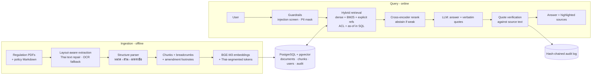

# Compliance Copilot

**A trustworthy RAG assistant for Thai banking & securities compliance teams.**
Ask about PDPA, anti-money-laundering law, Bank of Thailand and SEC rules, or internal
policy — every sentence in the answer is cited down to the มาตรา / ข้อ, and every
citation is *checked against the source text by code* before it is shown.

> In compliance, "probably right" is not good enough. The system is designed around one
> rule: **no verifiable evidence → no answer.**

---

## What it does

- **Grounded Q&A** over 8 real Thai regulations and 6 (synthetic) internal bank policies.
  The model must return a verbatim quote for every citation; quotes that cannot be found
  in the cited passage are discarded and the sentence is flagged.
- **Permission-aware retrieval** — document classification and department scoping are
  enforced in the *same SQL query* as the vector search, so restricted text never reaches
  the prompt, the answer or the logs.
- **Time-aware answers** — "what was the gift limit as of June 2024?" retrieves the policy
  version in force on that date; pending amendments (e.g. SEC ทธ. 53/2568 amending
  ทธ. 35/2556) are surfaced as warnings.
- **Abstains** when evidence is weak (calibrated reranker threshold) instead of guessing.
- **Guardrails** — PII (Thai national ID with checksum, phone, account, card with Luhn,
  names) is masked *before* the LLM call; prompt-injection attempts are refused.
- **Private chat history** — saved per user with PII already masked, re-checked against
  the user's *current* permissions when reopened, deletable by the user (PDPA), purged after a
  retention period, and kept separate from the append-only audit trail.
- **Tamper-evident audit trail** — every question/answer/retrieval is logged in a SHA-256
  hash chain; editing any historical row is detectable.
- **Policy Gap Analysis** — checks each clause of an internal policy against the
  regulations in force and produces a reviewable worklist with verified citations.
- **Evaluation harness** — 51-question golden set, deterministic metrics, retrieval
  ablation, threshold calibration.

## Results

Retrieval ablation on the golden set (answerable questions, top-6 context, RTX 4060 Ti):

| Configuration | Hit@1 | Hit@6 | Recall@6 | MRR | Leakage |
|---|---|---|---|---|---|
| A. Fixed-size chunks + vector only (baseline) | 0.35 | 0.575 | 0.537 | 0.434 | 0 |
| B. Structure-aware chunks + vector only | 0.625 | 0.900 | 0.887 | 0.742 | 0 |
| C. Structure-aware chunks + BM25 only | 0.50 | 0.825 | 0.787 | 0.622 | 0 |
| D. Hybrid (vector + BM25 + references, RRF) | 0.625 | 0.900 | 0.887 | 0.740 | 0 |
| E. Hybrid + cross-encoder rerank | 0.85 | 0.975 | 0.963 | 0.891 | 0 |
| **F. E + glossary expansion + comparison lookup (production)** | **0.85** | **1.000** | **1.000** | **0.900** | **0** |

- Chunking by legal unit (มาตรา/ข้อ) instead of fixed windows is the single biggest win.
- The reranker separates in-corpus from out-of-corpus questions cleanly (lowest answerable
  question 0.24 vs highest out-of-corpus 0.008), so the abstention threshold (0.15)
  makes no mistakes on this set.
- Confidential-document leakage is 0 in every configuration.
- The glossary (F) closes a vocabulary gap the eval exposed: users say "ข้อมูลอ่อนไหว" but
  PDPA มาตรา 26 never uses that word. Because the fix was informed by this set, F's last
  points should be confirmed on held-out questions.

End-to-end on all 51 questions with Gemini 3.1 Flash Lite:

| Metric | Result |
|---|---|
| Correct behaviour (answer / abstain / block) | **100%** |
| Key facts correct in answers | **100%** |
| Cited quotes found verbatim in the cited source | 97.4% |
| Gold evidence cited (citation recall) | 98.8% |
| Confidential-document leakage | **0** |
| PII masked before the LLM | 100% |
| Latency p50 / p95 | 3.5 s / 8.8 s |

The first full run scored 96% and exposed two real defects, both fixed with regression
tests: the injection filter blocked a legitimate question containing "ยกเลิกกฎกระทรวง"
(legal wording), and a "does our policy comply with the law?" question retrieved only the
policy. Comparison questions now also look up the regulation governing the policy clause.

Policy Gap Analysis on the synthetic PDPA policy found both planted conflicts (breach
notification "7 days" vs 72 hours in มาตรา 37(4); access requests "45 days" vs 30 days in
มาตรา 30) plus six genuine omissions, each with a quote verified against the Act.

Full report: [`docs/eval-report.md`](docs/eval-report.md).

## Architecture



| Layer | Choice | Why |
|---|---|---|
| Storage | PostgreSQL 16 + pgvector (HNSW) | ACL and effective-date filters live in the same query as similarity search; audit log in the same transactional store |
| Embeddings | BAAI/bge-m3 (local GPU/CPU) | Strong Thai performance; document text never leaves the environment for indexing |
| Lexical | PyThaiNLP `newmm` segmentation + BM25 with corpus IDF | Thai has no spaces; Postgres FTS alone has no IDF |
| Reranker | BAAI/bge-reranker-v2-m3 | +7.5 pts Hit@6, and a calibrated score for abstention |
| Query expansion | Curated domain glossary | Bridges colloquial terms ("ข้อมูลอ่อนไหว", "บัญชีม้า") to statutory wording |
| LLM | Gemini 3.5 Flash (pluggable; Claude provider included) | Provider-agnostic: grounding is verified by our code, not by a provider feature |
| API | FastAPI, JWT, role-based endpoints | Authorisation lives server-side; the UI is untrusted |
| Web | Next.js 16 + shadcn/ui, BFF proxy with httpOnly cookie | Session token is never readable by browser JavaScript |

Details and design decisions: [`docs/architecture.md`](docs/architecture.md).

## Thai document processing — the unglamorous part that matters

Text extracted from Thai government PDFs is systematically corrupted, which silently
destroys both keyword search and embeddings. The ingestion pipeline repairs:

- **Broken SARA AM** — `ก าหนด` → `กำหนด`, `ต ่าสุด` → `ต่ำสุด` (font drops NIKHAHIT).
- **Swapped SARA AA/AM in bold fonts** — `อ ำนำจตำมกฎหมำย` → `อำนาจตามกฎหมาย`, diagnosed
  per font *per page* (merged PDFs reuse font names with different encodings) and, where
  ambiguous, decided by a dictionary-based "garble score".
- **Private-Use-Area glyphs**, Thai digits (๒๖ → 26), running headers/footers, Royal Gazette
  page headers, and **amendment footnotes**, which are separated from the body and attached
  to the section they amend ("มาตรา 22/1 แก้ไขเพิ่มเติมโดย…").
- **Scanned pages** are detected (no text layer) and transcribed by the LLM once, cached and
  flagged as OCR in the UI.

## Quick start

Requirements: Python 3.12 + [uv](https://docs.astral.sh/uv/), Docker, Node 20+, a Gemini
API key (optional — without it the app runs in retrieval-only mode).

```bash
cp .env.example .env            # add COPILOT_GEMINI_API_KEY
docker compose up -d db         # Postgres + pgvector on :5433
uv sync                         # Python deps (CUDA torch on Windows/Linux)
uv run copilot setup            # schema, demo users, fetch PDFs, ingest
uv run uvicorn compliance_copilot.api.main:app --port 8000
```

```bash
cd web && npm install && npm run dev    # http://localhost:3000
```

Demo accounts are in [`config/users.yaml`](config/users.yaml) (employee, compliance
officer, internal auditor, admin) — try the same question as `somchai` and `nida` to see
access control in action.

Useful commands:

```bash
uv run copilot ask "ต้องเก็บข้อมูล CDD กี่ปีหลังปิดบัญชี" --user somchai
uv run copilot gap pol-pdpa-001 --out gap.md
uv run copilot eval --no-e2e          # retrieval ablation only (no LLM calls)
uv run copilot audit-verify
uv run pytest                         # 52 tests (integration tests need the DB)
```

## Corpus

| Document | Regulator | Source |
|---|---|---|
| พ.ร.บ.คุ้มครองข้อมูลส่วนบุคคล พ.ศ. 2562 | สคส. | สำนักงานคณะกรรมการกฤษฎีกา |
| ประกาศ กคส. เรื่องการแจ้งเหตุละเมิดข้อมูลส่วนบุคคล พ.ศ. 2565 | สคส. | mirror (Royal Gazette blocks scripts) |
| พ.ร.บ.ป้องกันและปราบปรามการฟอกเงิน พ.ศ. 2542 (ฉบับประมวล) | ปปง. | sed.amlo.go.th |
| กฎกระทรวงการตรวจสอบเพื่อทราบข้อเท็จจริงเกี่ยวกับลูกค้า พ.ศ. 2563 | ปปง. | sed.amlo.go.th |
| ประกาศ ธปท. การให้สินเชื่ออย่างรับผิดชอบและเป็นธรรม (2566) | ธปท. | bot.or.th |
| Joint Policy Statement ธปท.–ปปง. ด้าน Sanctions (2567) | ธปท. | bot.or.th (partly scanned → OCR) |
| ประกาศ ทธ. 35/2556 (ฉบับประมวล) | ก.ล.ต. | thaibma.or.th mirror |
| หนังสือเวียน ก.ล.ต. ที่ กลต.นป.(ว) 50/2568 | ก.ล.ต. | thaibma.or.th mirror |

Every file is pinned by SHA-256 in `data/raw/manifest.lock.json` with its official
reference. Thai statutes and regulator notifications are not copyright works (พ.ร.บ.ลิขสิทธิ์
มาตรา 7). Internal policies in `data/internal/` are **fictional** ("ธนาคารเดโม่") and contain
deliberately planted gaps for the gap-analysis demo.

## Limitations & next steps

- Gold set is 51 questions written by one person; a production rollout needs questions
  sampled from real compliance queries and reviewed by the compliance team.
- End-to-end metrics depend on LLM quota; run `uv run copilot eval` (results are cached
  so interrupted runs resume).
- Vocabulary gaps between how staff ask and how statutes are worded are handled by a
  curated glossary (`data/glossary.yaml`); it needs an owner and a review process.
- Production hardening: SSO/OIDC instead of demo passwords, Postgres row-level security as
  a second ACL layer, an on-prem LLM option for data residency, streaming responses,
  scheduled re-ingestion when regulators publish amendments.

## Project layout

```
src/compliance_copilot/
  ingestion/   thai_text · pdf_extract · structure · chunker · loaders · pipeline
  retrieval/   retriever (hybrid + ACL + as-of) · bm25 · models · text_index
  generation/  prompts · answerer · citations (quote verification)
  guardrails/  pii · input_guard
  features/    gap_analysis
  api/         FastAPI app
  audit.py · security.py · evaluation.py · llm.py · cli.py
web/           Next.js + shadcn/ui frontend (BFF proxy, chat, documents, gap, audit, eval)
data/          sources.yaml (manifest) · internal/ (synthetic policies)
eval/          golden_set.yaml · results/
tests/         unit + integration tests
```
