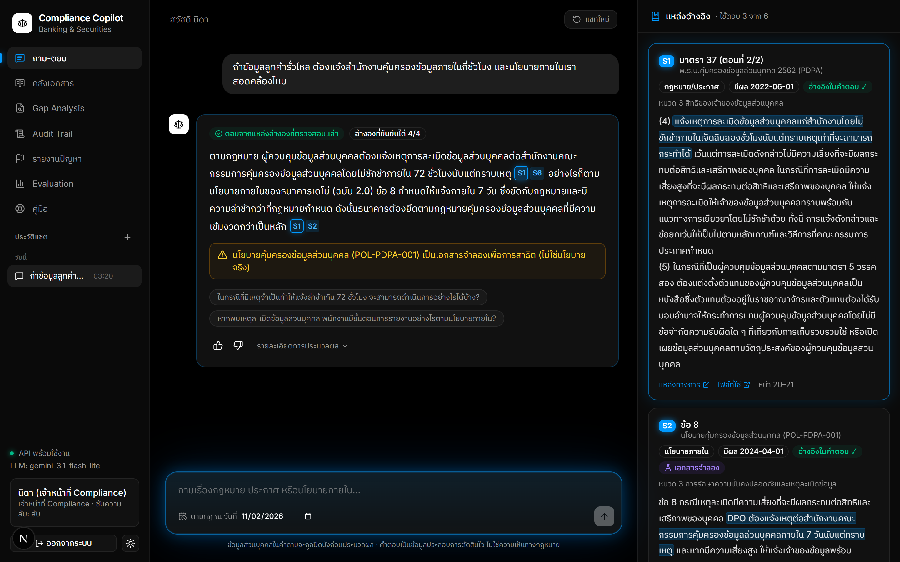
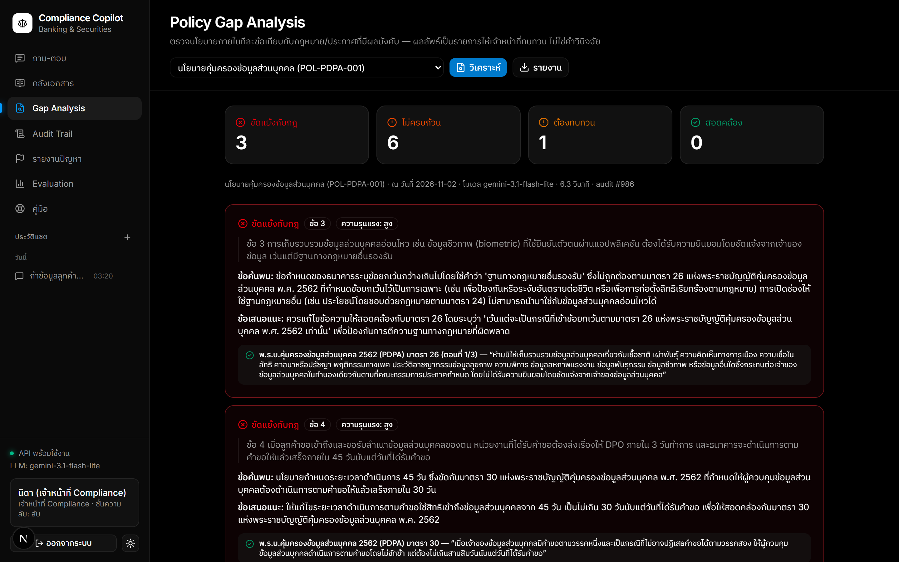
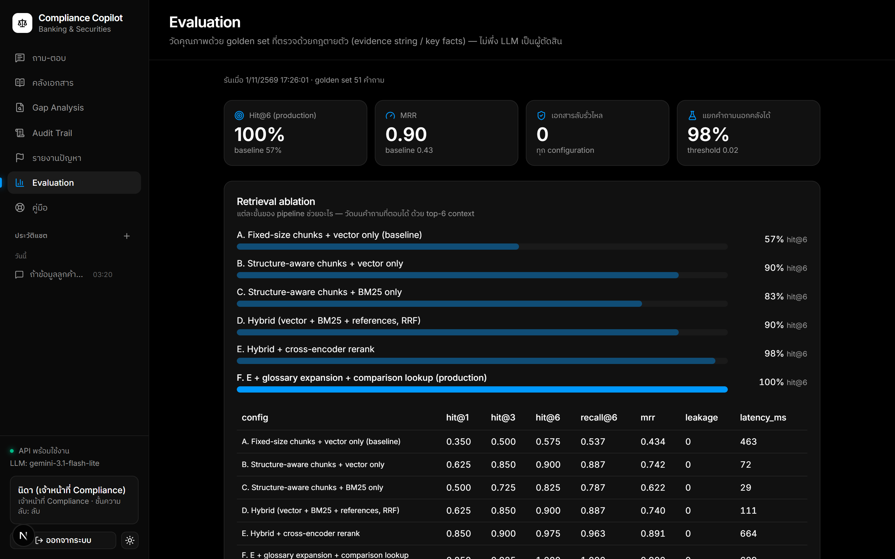
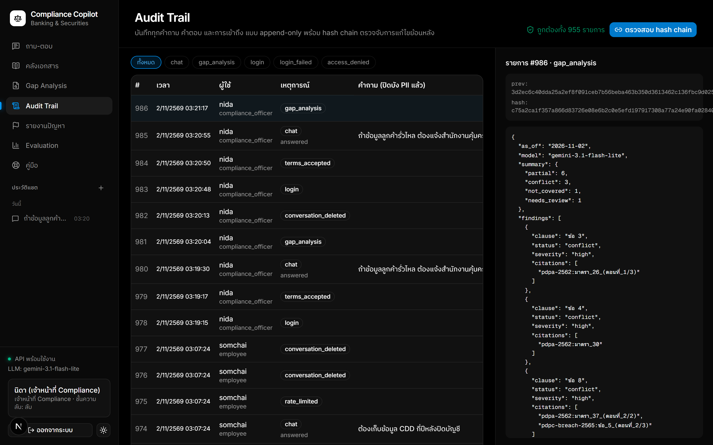
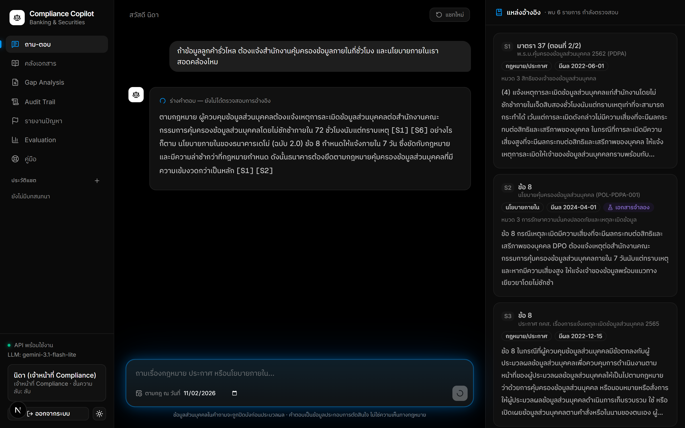
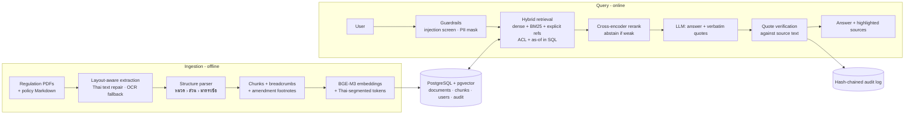

# Compliance Copilot

**A trustworthy RAG assistant for Thai banking & securities compliance teams.**
Ask about PDPA, anti-money-laundering law, Bank of Thailand and SEC rules, or internal
policy — every sentence in the answer is cited down to the มาตรา / ข้อ, and every
citation is *checked against the source text by code* before it is shown.

> In compliance, "probably right" is not good enough. The system is designed around one
> rule: **no verifiable evidence → no answer.**



<table>
  <tr>
    <td></td>
    <td></td>
  </tr>
  <tr>
    <td></td>
    <td></td>
  </tr>
</table>

---

## What it does

- **Grounded Q&A** over 8 real Thai regulations and 6 (synthetic) internal bank policies.
  The model must return a verbatim quote for every citation; quotes that cannot be found
  in the cited passage are discarded and the sentence is flagged.
- **Permission-aware retrieval** — document classification and department scoping are
  enforced in the *same SQL query* as the vector search, so restricted text never reaches
  the prompt, the answer or the logs.
- **Defence in depth** — the same permission rule is enforced twice: in the retrieval SQL and
  again by Postgres row-level security under a read-only role, so a query that forgets the
  filter still cannot return restricted text (tested by deleting the filter).
- **Abuse protection** — lockout after repeated wrong passwords, rate limits on the expensive
  endpoints, strict CSP/security headers, and a start-up check that refuses unsafe production
  settings. See [`docs/security.md`](docs/security.md) for the deployment checklist.
- **Single sign-on** — OpenID Connect (authorization code + PKCE). Role and clearance come from
  the identity provider's groups, not from this app; Keycloak included for local try-out.
- **Streaming answers** — real progress, the retrieved sources after about a second and the answer
  text as it is written (labelled as an unverified draft); the verified answer, with citations
  checked against the originals, replaces it at the end.
- **Time-aware answers** — "what was the gift limit as of June 2024?" retrieves the policy
  version in force on that date; pending amendments (e.g. SEC ทธ. 53/2568 amending
  ทธ. 35/2556) are surfaced as warnings.
- **Abstains** when evidence is weak (calibrated reranker threshold) instead of guessing.
- **Guardrails** — PII (Thai national ID with checksum, phone, account, card with Luhn,
  names) is masked *before* the LLM call; prompt-injection attempts are refused.
- **Private chat history** — saved per user with PII already masked, re-checked against
  the user's *current* permissions when reopened, deletable by the user (PDPA), purged after a
  retention period, and kept separate from the append-only audit trail.
- **Tamper-evident audit trail** — every question/answer/retrieval is logged in a SHA-256
  hash chain; editing any historical row is detectable.
- **Document governance** — internal policies cannot enter the index without an owner, approver,
  approval date and review date; only `approved` ones are searchable, review reminders show in
  the UI, and `copilot check-updates` detects when a regulator changes a pinned source.
- **Adoption controls** — users accept versioned acceptable-use terms (enforced by the API, audited);
  a thumbs-down opens a categorised problem report that compliance staff triage and close with a note the
  reporter sees; a "confidential material shown" report is raised as an incident. User guide and training
  plan, incident process, and a model-risk dossier with a generated evidence pack are in `docs/`.
- **Policy Gap Analysis** — checks each clause of an internal policy against the
  regulations in force and produces a reviewable worklist with verified citations.
- **Evaluation harness** — 218 questions in three sets (golden 51, held-out 21, extended 146),
  deterministic metrics, retrieval ablation, threshold calibration.

## Results

Retrieval ablation on the golden set (answerable questions, top-6 context, RTX 4060 Ti):

| Configuration | Hit@1 | Hit@6 | Recall@6 | MRR | Leakage |
|---|---|---|---|---|---|
| A. Fixed-size chunks + vector only (baseline) | 0.35 | 0.575 | 0.537 | 0.434 | 0 |
| B. Structure-aware chunks + vector only | 0.625 | 0.900 | 0.887 | 0.742 | 0 |
| C. Structure-aware chunks + BM25 only | 0.50 | 0.825 | 0.787 | 0.622 | 0 |
| D. Hybrid (vector + BM25 + references, RRF) | 0.625 | 0.900 | 0.887 | 0.740 | 0 |
| E. Hybrid + cross-encoder rerank | 0.85 | 0.975 | 0.963 | 0.891 | 0 |
| **F. E + glossary expansion + comparison lookup (production)** | **0.85** | **1.000** | **1.000** | **0.900** | **0** |

- Chunking by legal unit (มาตรา/ข้อ) instead of fixed windows is the single biggest win.
- Confidential-document leakage is 0 in every configuration.
- The glossary (F) closes a vocabulary gap the eval exposed: users say "ข้อมูลอ่อนไหว" but
  PDPA มาตรา 26 never uses that word. Because the fix was informed by this set, it was then
  checked on held-out questions (below).
- Abstention is two-layered: a low reranker threshold (0.02) skips the LLM only when
  nothing in the corpus is remotely relevant, and the LLM must return "insufficient
  evidence" when the retrieved passages do not answer the question. The held-out set showed
  that colloquial questions can score low ("กระเช้าปีใหม่" scored 0.04 against the gift
  policy), so a high threshold (the earlier 0.15) wrongly refused answerable questions.

End-to-end on all 51 questions with Gemini 3.1 Flash Lite:

| Metric | Result |
|---|---|
| Correct behaviour (answer / abstain / block) | **100%** |
| Key facts correct in answers | **100%** |
| Cited quotes found verbatim in the cited source | 97.4% |
| Gold evidence cited (citation recall) | 98.8% |
| Confidential-document leakage | **0** |
| PII masked before the LLM | 100% |
| Latency p50 / p95 (uncached LLM calls) | 3.5 s / 8.8 s |

The first full run scored 96% and exposed two real defects, both fixed with regression
tests: the injection filter blocked a legitimate question containing "ยกเลิกกฎกระทรวง"
(legal wording), and a "does our policy comply with the law?" question retrieved only the
policy. Comparison questions now also look up the regulation governing the policy clause.

### Held-out set — checking for overfitting

After tuning on the golden set, 21 new questions were written in the way staff actually
ask (colloquial, situation-based: "ลูกค้าส่งกระเช้าปีใหม่มาให้ 4,000 บาท รับได้ไหม") and run
**once, blind**, with no code changes:

| Metric | Blind run | After fixes (no longer blind) |
|---|---|---|
| Retrieval Hit@6 (production config) | 94.1% | 100% |
| Correct behaviour | 85.7% | 100% |
| Key facts correct | 76.5% | 100% |
| Gold evidence cited | 76.5% | 100% |
| Cited quotes verified | 97.6% | 98.0% |
| Confidential-document leakage | 0 | 0 |

The blind run found three real defects, each now covered by a regression test:

1. **Policy answered instead of the law** — asked whether a 45-day policy deadline is
   lawful, the system quoted the policy but never retrieved PDPA มาตรา 30 (30 days).
   When the top results are internal policy and no *relevant* regulation is among them, the
   retriever now looks up the regulation governing that policy clause.
2. **Over-cautious abstention** — colloquial questions scored below the 0.15 threshold and
   were refused although the answer was in the corpus; the threshold is now 0.02 (see above).
3. **PII miss** — "คุณสมศรี มีสุข" was not masked; names after the title "คุณ" are now masked
   when followed by a surname (without masking ordinary words such as "คุณสมบัติ").

The blind numbers are the honest estimate of performance on unseen questions; the
after-fix column is not, since the fixes were informed by this set. Reports:
[`docs/eval-report-holdout-blind.md`](docs/eval-report-holdout-blind.md),
[`docs/eval-report-holdout.md`](docs/eval-report-holdout.md).

### Extended set - 146 more questions, first run blind

Written after all tuning, from the statute text, across all 14 documents (colloquial wording, versions
by date, access control, refusals, prompt injection, personal data):

| | Result |
|---|---|
| Retrieval Hit@6, production, **first (blind) run** | 92.2% (baseline 51.6%) |
| Retrieval Hit@6 after six vocabulary fixes (**no longer blind**) | 97.7% |
| End-to-end correct behaviour | 94.5% |
| End-to-end key facts | 91.4% as run, 93.8% after correcting three over-strict expected wordings |
| Cited quotes verified / leakage / personal data masked | 95.9% / 0 / 100% |

The 8 behaviour misses are listed in [`docs/evaluation.md`](docs/evaluation.md): 4 answers whose quotes
could not be verified (the system fell back to source text), 2 answerable questions refused, and 2
access-control cases where the system said the detail was unavailable and answered from permitted
documents instead of refusing outright (nothing confidential was disclosed). End-to-end was run with the
batch model because the chat model's daily quota was used up.

**No question is expert-confirmed yet (0 of 218).** `copilot eval-review export` produces a workbook for
the compliance team, `import` records their verdicts (a later edit makes a verdict stale), and
`copilot feedback-report --draft` turns a thumbs-down into a question skeleton for an expert.

Policy Gap Analysis now reads each regulation together with the Act it is issued under and tells the model
the legal level of every source. On the synthetic PDPA policy it found both planted conflicts (breach
notification "7 days" vs 72 hours in มาตรา 37(4), citing the Act and the PDPC notification; access
requests "45 days" vs 30 days in มาตรา 30) plus four omissions and one arguable high-severity finding
(clause 3 vs มาตรา 26) for the compliance team to judge.

Full report: [`docs/eval-report.md`](docs/eval-report.md).

## Architecture



| Layer | Choice | Why |
|---|---|---|
| Storage | PostgreSQL 16 + pgvector (HNSW) | ACL and effective-date filters live in the same query as similarity search; audit log in the same transactional store |
| Embeddings | BAAI/bge-m3 (local GPU/CPU) | Strong Thai performance; document text never leaves the environment for indexing |
| Lexical | PyThaiNLP `newmm` segmentation + BM25 with corpus IDF | Thai has no spaces; Postgres FTS alone has no IDF |
| Reranker | BAAI/bge-reranker-v2-m3 | +7.5 pts Hit@6, and a calibrated score for abstention |
| Query expansion | Curated domain glossary | Bridges colloquial terms ("ข้อมูลอ่อนไหว", "บัญชีม้า") to statutory wording |
| LLM | Gemini 3.5 Flash (pluggable; Claude provider included) | Provider-agnostic: grounding is verified by our code, not by a provider feature |
| API | FastAPI, JWT, role-based endpoints | Authorisation lives server-side; the UI is untrusted |
| Web | Next.js 16 + shadcn/ui, BFF proxy with httpOnly cookie | Session token is never readable by browser JavaScript |

Details and design decisions: [`docs/architecture.md`](docs/architecture.md). Containers, CI, monitoring, backups and measured capacity: [`docs/deployment.md`](docs/deployment.md). Rolling it out: [`docs/user-guide.md`](docs/user-guide.md) (Thai: guide, training, pilot), [`docs/incident-process.md`](docs/incident-process.md) (Thai), [`docs/portfolio.md`](docs/portfolio.md) (portfolio write-up, EN + TH), [`docs/readiness-checklist.md`](docs/readiness-checklist.md) (Thai: what is done vs. what the bank must do), [`docs/model-risk.md`](docs/model-risk.md) (Thai: risk register, validation, approval checklist) with the generated [`docs/evidence/model-card.md`](docs/evidence/model-card.md). Roles, intake rules and decisions the organisation must make: [`docs/governance.md`](docs/governance.md) (Thai).

## Thai document processing — the unglamorous part that matters

Text extracted from Thai government PDFs is systematically corrupted, which silently
destroys both keyword search and embeddings. The ingestion pipeline repairs:

- **Broken SARA AM** — `ก าหนด` → `กำหนด`, `ต ่าสุด` → `ต่ำสุด` (font drops NIKHAHIT).
- **Swapped SARA AA/AM in bold fonts** — `อ ำนำจตำมกฎหมำย` → `อำนาจตามกฎหมาย`, diagnosed
  per font *per page* (merged PDFs reuse font names with different encodings) and, where
  ambiguous, decided by a dictionary-based "garble score".
- **Private-Use-Area glyphs**, Thai digits (๒๖ → 26), running headers/footers, Royal Gazette
  page headers, and **amendment footnotes**, which are separated from the body and attached
  to the section they amend ("มาตรา 22/1 แก้ไขเพิ่มเติมโดย…").
- **Scanned pages** are detected (no text layer) and transcribed by the LLM once, cached and
  flagged as OCR in the UI.

## Quick start

Requirements: Python 3.12 + [uv](https://docs.astral.sh/uv/), Docker, Node 20+, a Gemini
API key (optional — without it the app runs in retrieval-only mode).

```bash
cp .env.example .env            # add COPILOT_GEMINI_API_KEY
docker compose up -d db         # Postgres + pgvector on :5433
uv sync                         # Python deps (CUDA torch on Windows/Linux)
uv run copilot setup            # schema, demo users, fetch PDFs, ingest
uv run uvicorn compliance_copilot.api.main:app --port 8000
```

```bash
cd web && npm install && npm run dev    # http://localhost:3000
```

Optional SSO try-out with a local Keycloak (test users `sso.employee` / `sso.compliance` /
`sso.nogroup`, password `demo-sso`, defined in [`config/keycloak/`](config/keycloak/copilot-realm.json)):

```bash
docker compose --profile sso up -d keycloak     # http://localhost:8081
# then uncomment the COPILOT_OIDC_* lines in .env and restart the API
```

The login page shows an SSO button only when `COPILOT_OIDC_ISSUER` is set. Group → role
mapping is in [`config/sso.yaml`](config/sso.yaml).

Demo accounts are in [`config/users.yaml`](config/users.yaml) (employee, compliance
officer, internal auditor, admin) — try the same question as `somchai` and `nida` to see
access control in action.

Useful commands:

```bash
uv run copilot ask "ต้องเก็บข้อมูล CDD กี่ปีหลังปิดบัญชี" --user somchai
uv run copilot gap pol-pdpa-001 --out gap.md
uv run copilot eval --no-e2e          # retrieval ablation only (no LLM calls)
uv run copilot eval --set holdout     # held-out set (also: --set extended, --reviewed-only, --production-only)
uv run copilot eval-review status     # how much of each set an expert has confirmed
uv run copilot evidence-pack          # model card for model-risk review, generated from the running system
uv run copilot feedback-report --open # unresolved problem reports (close with feedback-resolve)
uv run copilot audit-verify
uv run copilot add-policy my-policy.md --dry-run   # validate + preview a real policy before adding it
uv run copilot check-updates          # has a regulator changed a pinned source? (read-only)
uv run copilot governance             # reviews due, drafts, sample documents still in the corpus
uv run copilot bench                  # retrieval capacity on this machine (no LLM)
uv run pytest                         # 550 tests (integration tests need the DB)
```

A scripted 4-minute demo walkthrough is in [`docs/demo-script.md`](docs/demo-script.md).
The UI also works on phones (sidebar becomes a drawer, sources open as a bottom sheet).

## Corpus

| Document | Regulator | Source |
|---|---|---|
| พ.ร.บ.คุ้มครองข้อมูลส่วนบุคคล พ.ศ. 2562 | สคส. | สำนักงานคณะกรรมการกฤษฎีกา |
| ประกาศ กคส. เรื่องการแจ้งเหตุละเมิดข้อมูลส่วนบุคคล พ.ศ. 2565 | สคส. | mirror (Royal Gazette blocks scripts) |
| พ.ร.บ.ป้องกันและปราบปรามการฟอกเงิน พ.ศ. 2542 (ฉบับประมวล) | ปปง. | sed.amlo.go.th |
| กฎกระทรวงการตรวจสอบเพื่อทราบข้อเท็จจริงเกี่ยวกับลูกค้า พ.ศ. 2563 | ปปง. | sed.amlo.go.th |
| ประกาศ ธปท. การให้สินเชื่ออย่างรับผิดชอบและเป็นธรรม (2566) | ธปท. | bot.or.th |
| Joint Policy Statement ธปท.–ปปง. ด้าน Sanctions (2567) | ธปท. | bot.or.th (partly scanned → OCR) |
| ประกาศ ทธ. 35/2556 (ฉบับประมวล) | ก.ล.ต. | thaibma.or.th mirror |
| หนังสือเวียน ก.ล.ต. ที่ กลต.นป.(ว) 50/2568 | ก.ล.ต. | thaibma.or.th mirror |

Every file is pinned by SHA-256 in `data/raw/manifest.lock.json` with its official
reference. Thai statutes and regulator notifications are not copyright works (พ.ร.บ.ลิขสิทธิ์
มาตรา 7). Internal policies in `data/internal/` are **fictional** ("ธนาคารเดโม่") and contain
deliberately planted gaps for the gap-analysis demo.

## Limitations & next steps

- The six internal policies are fictional samples (one review date is deliberately overdue to show the
  reminder). Replacing them with approved policies, and choosing which further regulations the business
  needs (e.g. the Securities and Exchange Act, banking-supervision notifications), is the organisation's
  decision - see `docs/governance.md`. `check-updates` reports a source as *unreachable* rather than
  unchanged when the publisher blocks it.
- All 218 evaluation questions were written by engineers and none is expert-confirmed yet;
  a production rollout needs questions sampled from real compliance queries, confirmed by the
  compliance team (workflow: `docs/evaluation.md`), and a fresh blind set after every round of fixes.
- End-to-end metrics depend on LLM quota; run `uv run copilot eval` (results are cached
  so interrupted runs resume).
- Vocabulary gaps between how staff ask and how statutes are worded are handled by a
  curated glossary (`data/glossary.yaml`); it needs an owner and a review process.
- SSO is tested against Keycloak and a fake provider; a real bank IdP (Entra ID, Okta) needs
  its group claim name checked, session logout (single logout) and token refresh. RLS covers
  document reads; user-owned tables (chat history, feedback) are still protected in the API only.
- Capacity: one API process handles about 2 questions/second of retrieval on an 8 GB GPU (the models
  sit behind one lock); CPU-only is ~20x slower and only fit for demos. Scale with one replica per
  GPU - see `docs/deployment.md`.
- Production hardening: an on-prem LLM option for data residency, scheduled re-ingestion when regulators publish amendments.

## Project layout

```
src/compliance_copilot/
  ingestion/   thai_text · pdf_extract · structure · chunker · loaders · pipeline
  retrieval/   retriever (hybrid + ACL + as-of) · bm25 · models · text_index
  generation/  prompts · answerer · citations (quote verification)
  guardrails/  pii · input_guard
  features/    gap_analysis
  api/         FastAPI app
  audit.py · security.py · evaluation.py · llm.py · cli.py
web/           Next.js + shadcn/ui frontend (BFF proxy, chat, documents, gap, audit, eval)
data/          sources.yaml (manifest) · internal/ (synthetic policies)
eval/          golden_set.yaml · holdout_set.yaml · extended/ · review/ (expert verdicts) · results/
tests/         unit + integration tests
```
