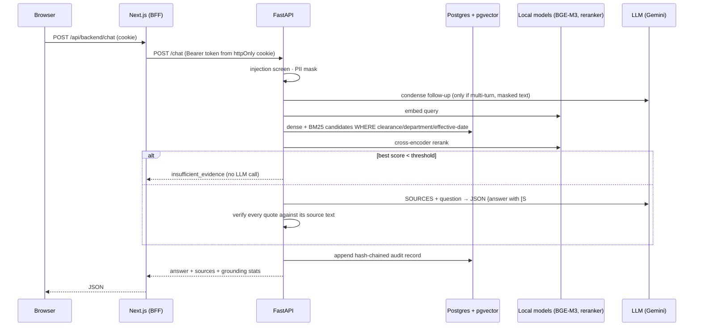

# Architecture & design decisions

## 1. Request lifecycle

## 2. Data model

| Table | Purpose |
|---|---|
| `documents` | One row per document version: classification, departments, effective_from/to, supersedes/superseded_by, amended_by, provenance (source URL, official reference, SHA-256), extraction quality |
| `chunks` | Citable units (มาตรา/ข้อ) with breadcrumb path, amendment notes, page span, `embedding vector(1024)` (HNSW), `tokens_text` + generated `tsvector`, `strategy` (structured / naive for ablation) |
| `users` | Demo identities: role, department, clearance (scrypt password hashes) |
| `audit_log` | Append-only events with `prev_hash` / `hash` (SHA-256 chain) |
| `feedback` | 👍/👎 per audited answer |
| `conversations`, `conversation_messages` | Per-user chat history: masked questions + full answers with sources; owner-only; purged after `COPILOT_CHAT_RETENTION_DAYS` |

## 3. Key decisions

### Structure-aware chunking over fixed windows
Legal text is cited by มาตรา/ข้อ, and a fixed 1,000-character window routinely splits a
provision or merges two. The parser recognises หมวด / ส่วน / มาตรา / ข้อ and outline numbering
(5.3.1, เอกสารแนบ N), validating each heading as a *successor* of the previous number so a
wrapped line that happens to start with "มาตรา 95 และ…" is not mistaken for a heading.
Measured effect: Hit@6 0.575 → 0.900.

### Hybrid retrieval with BM25 computed in Python
Thai legal questions mix paraphrase ("ข้อมูลรั่ว") with exact terms ("มาตรา 22/1", "CDD").
Dense retrieval handles the first; lexical handles the second. Postgres FTS gives us
filtering and a GIN prefilter, but `ts_rank` has no IDF, so BM25 is computed over the
prefiltered rows with document frequencies cached from the corpus. Explicit references
("PDPA มาตรา 26") are looked up directly. Results are fused with Reciprocal Rank Fusion.

### Access control inside the retrieval query
The ACL predicate (`classification_level <= clearance AND (departments = [] OR department ∈
departments)`) and the effective-date predicate are part of every first-stage SQL query.
Consequences: restricted text cannot reach the reranker, the prompt, the answer or the
audit log; and there is one place to review.

**Second layer: Postgres row-level security.** A query that forgets that predicate is the
classic way an ACL fails, so the database enforces it too. Reads made on behalf of a user
run `SET LOCAL ROLE copilot_reader` and pass the user's clearance and department as
transaction-local settings (`app.clearance`, `app.department`); RLS policies on `documents`
and `chunks` then hide every row the user may not see. The role has `SELECT` only, and with
no settings it sees nothing (fail closed). A test deletes the ACL lines from the retrieval
SQL and asserts that the confidential procedure still does not leak. Ingestion, audit and
admin tasks keep the owner connection, which RLS does not apply to; BM25 corpus statistics
are computed on that connection so ranking does not depend on who is asking.

### Single sign-on (OIDC)
`sso.py` implements the authorization-code flow with PKCE against any OIDC provider
(Keycloak locally; Entra ID / Okta in production). The web tier's `/api/auth/sso/*` routes
only move the browser around: the API creates a signed state token (CSRF `state`, `nonce`,
PKCE verifier) that lives in a short-lived httpOnly cookie, exchanges the code, and verifies
the ID token's signature (JWKS), issuer, audience, expiry and nonce. Role, department and
clearance come from the IdP's `groups` claim through `config/sso.yaml` (highest clearance
wins; no mapped group = refused), so access is granted and revoked in the bank's IAM, not
here. Users are provisioned on first sign-in and linked by the stable `sub` claim, never by
username: an IdP user called `somchai` becomes `somchai.sso` and cannot touch the local
account. SSO accounts have no password and cannot use the demo login. After sign-in the
user holds the same session token as before, so RBAC, RLS and audit are unchanged.

### Streaming without giving up verification
Waiting 5-30 s for a blank screen is poor, but the design rule is *no verifiable evidence → no
answer*, and a quote can only be checked once the model has finished. `POST /chat/stream`
therefore sends newline-delimited JSON events in the order the work happens: `stage`
(guard → retrieve → generate → verify), `sources` (the permission-filtered passages, as soon
as retrieval ends - about a second in), `delta` (the answer text as it is written) and a
`final` event with the verified response. The UI labels the streamed text *"draft - citations
not yet checked"* and replaces it with the final answer; if verification fails the final
answer is the source text, not the draft. Consequences handled in code:

- the provider drops the stream mid-way (Gemini 503 "high demand"): the generation is
  restarted and a `reset` event tells the UI to discard the partial draft;
- the reader disconnects after receiving draft text: an audit record `chat_interrupted`
  stores what was delivered, so nothing shown to a user is unaccounted for;
- providers without native streaming (Claude here, test fakes) deliver the whole answer as
  one `delta`, so every code path works with every provider;
- `/chat` (blocking) is the same pipeline consumed to the end - used by evaluation, which
  must not depend on timing - and shares the rate limit with `/chat/stream`.

### Governance gates the index
Internal documents carry `owner`, `approved_by`, `approved_on`, `review_due` and `status` in their
front matter. `governance.validate` runs at the start of every ingest and fails with *all*
problems at once; `status != approved` documents are never indexed and are deleted from the index
if they were (drafts, withdrawn). Replaced versions stay `approved` and are retired by
`effective_to`, so "as of" queries keep working - and are exempt from review reminders. Stored in
`documents.governance` (JSONB) and shown in the document register. Public sources are pinned by
SHA-256; `check-updates` compares them read-only with the publisher and stamps `checked_at`.

### Verify citations in code, not by trusting the model
The model returns `{answer, citations: [{source_id, quote}]}`. Each quote must be found in
the cited source (exact, whitespace-insensitive for Thai, or ≥ 85% contiguous match).
Unverifiable citations are dropped and their markers rendered red; if nothing verifies,
the user sees the source passages instead of the generated text. This works with any LLM
(Gemini, Claude, an on-prem model) and turns "faithfulness" into a deterministic metric.

### Abstain before generating
If the best reranker score is below a threshold calibrated on the golden set, the system
answers "insufficient evidence" without calling the LLM — cheaper, faster, and nothing to
hallucinate from. Calibration: answerable ≥ 0.24, out-of-corpus ≤ 0.008, threshold 0.15.

### Versioned documents, not overwritten ones
Policies have `effective_from/to`; superseded versions stay in the corpus. Questions are
answered "as of" a date (default today), which also lets compliance officers reconstruct
what the rule was when an incident happened. Consolidated regulations carry `amended_by`
entries so pending amendments are surfaced as warnings.

### Tamper-evident audit
`hash = sha256(prev_hash ‖ canonical_json(record))`, writers serialised with a
transaction-scoped advisory lock. Records store masked questions, retrieved chunk ids and
scores, cited chunks, model and prompt versions, latency and token use — enough to
reconstruct any answer.

### Chat history separate from the audit trail
The audit log must be append-only for oversight; a user's chat history must be deletable
(PDPA data-subject rights). Keeping them in separate tables satisfies both: deleting a
conversation removes it from the user's view while the masked audit record - and an audit
event recording the deletion - remain. History stores masked questions only, is owner-only
(404 for anyone else), re-filters sources against the user's *current* clearance when
reopened (an answer that cited a now-forbidden source is withheld), is used only for
follow-up context and never as a knowledge source, and is purged after the retention period.

### LLM provider abstraction
The app needs only "JSON output against a schema" and "text from images". Gemini and Claude
providers implement that interface; batch jobs (eval, gap analysis) can use a different
model with its own quota and are disk-cached so re-runs cost nothing.

### BFF (backend-for-frontend)
The browser talks only to Next.js route handlers; the JWT sits in an `httpOnly`,
`SameSite=Lax` cookie and is attached server-side when proxying to FastAPI, through an
allow-list of API prefixes. FastAPI re-reads role/clearance from the database on every
request, so revoking access is immediate.

## 4. Security & privacy summary

| Risk | Control |
|---|---|
| Hallucinated legal requirement | Quote verification, abstention threshold, "partial"/"insufficient" statuses, disclaimer |
| Unauthorised disclosure | ACL in retrieval SQL **and** Postgres row-level security (fail closed), department scoping, API role checks, 404 (not 403) for hidden documents |
| Password guessing / abuse of LLM quota | Account lockout (DB-backed), per-address and per-user rate limits, uniform responses for unknown usernames |
| Credential sprawl / slow offboarding | OIDC SSO with PKCE; access from IdP groups, re-evaluated at every sign-in; SSO users have no local password |
| Customer PII sent to LLM / logs | Regex + checksum PII masking before LLM, audit stores masked text only |
| Prompt injection (user or document) | Input screening, system prompt treats sources/questions as data, ACL independent of the model |
| Stale rules | Effective dating, as-of queries, amendment notices, SHA-256 pinned sources |
| Tampered records | Hash-chained audit with verification endpoint |
| Token theft via XSS | httpOnly cookie, BFF allow-list |

## 5. Operating characteristics (RTX 4060 Ti, local)

- Ingestion of 14 documents (≈520 structured + ≈480 baseline chunks): ~60 s.
- Retrieval incl. rerank: ~0.5–0.8 s; LLM answer (Gemini Flash): ~3–5 s.
- Gap analysis of an 11-clause policy: ~1–3 min (parallel, rate-limit aware).
