# Compliance Copilot — portfolio write-up

ไฟล์นี้เตรียมไว้ให้คัดลอกไปทำ portfolio / LinkedIn / เรซูเม่ มีสองภาษา: ภาษาอังกฤษ (ส่วนที่ 1–8) และภาษาไทย (ส่วนที่ 9)
ตัวเลขทุกตัวมาจากผลทดสอบจริงใน repo (`docs/evaluation.md`, `docs/deployment.md`) ถ้าจะแก้ตัวเลข ให้ตรวจกับไฟล์เหล่านั้นก่อน

---

## 1. One-liner

**A trustworthy RAG assistant for Thai banking & securities compliance: every sentence is cited to the exact section of the law, the citation is verified in code against the source text, and when evidence is weak it refuses to answer.**

Stack: Python · FastAPI · PostgreSQL + pgvector · BGE-M3 + cross-encoder reranker · Gemini · Next.js 16 + shadcn/ui · Docker · GitHub Actions · Prometheus

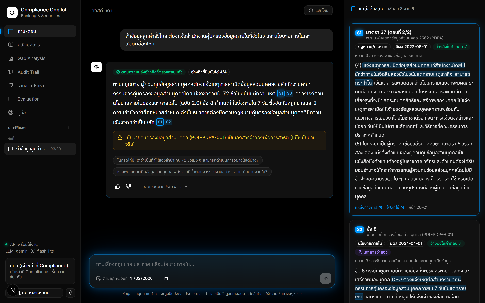

## 2. The problem

Compliance teams answer legal questions every day, and "probably right" is not good enough. A generic chatbot hallucinates section numbers, mixes old and new versions of a rule, ignores who is allowed to see which document, and leaves no audit trail. The design rule here is **no verifiable evidence → no answer**.

## 3. What I built

| Capability | How it works |
|---|---|
| **Verified citations** | The model must return a verbatim quote for every citation. Code checks that the quote exists in the cited passage; failures are flagged, and if none verify the user sees the source text instead of the answer. |
| **Abstention** | If the best reranker score is below a calibrated threshold, no LLM call is made. The model must also return `insufficient_evidence` when passages don't answer. |
| **Thai legal documents** | PDF repair for broken Thai text (SARA AM, swapped glyphs in bold fonts, private-use characters, Thai digits), structure parser for มาตรา/ข้อ, amendment footnotes, OCR for scanned pages. |
| **Hybrid retrieval** | BGE-M3 dense + Thai-segmented BM25 + explicit section lookup, rank fusion, cross-encoder rerank, query expansion with a curated glossary (staff say "ข้อมูลอ่อนไหว", the Act says otherwise). |
| **Time-aware** | Answers follow the version in force on a chosen date; old policy versions stay searchable. Pending amendments are surfaced as warnings. |
| **Access control, twice** | Clearance/department filter inside the retrieval SQL **and** PostgreSQL row-level security under a read-only role (a test deletes the SQL filter and confirms nothing leaks). |
| **Privacy & guardrails** | PII masking before the LLM (Thai ID checksum, Luhn cards, phones, emails, names), prompt-injection screening, per-user chat history that is masked, owner-only and deletable. |
| **Audit** | Hash-chained audit log, re-verified hourly in the background and exposed as an alertable metric. |
| **Policy gap analysis** | Checks each clause of an internal policy against the law (reading an Act together with its subordinate notification) and outputs a reviewable worklist with verified quotes. |
| **Streaming UX** | Real pipeline progress, sources after ~1 s, text from ~2–4 s, labelled as an unverified draft until the citations are checked; recovers when the provider drops the stream. |
| **Enterprise basics** | OIDC SSO (PKCE), account lockout, rate limits, CSP, acceptable-use terms enforced server-side, problem-report triage, versioned governance for internal policies. |
| **Ops** | Docker images, production compose (read-only containers, secrets as files), CI, backup + tested restore, Prometheus metrics with 12 alert rules about *trustworthiness*, not just uptime. |

## 4. Architecture

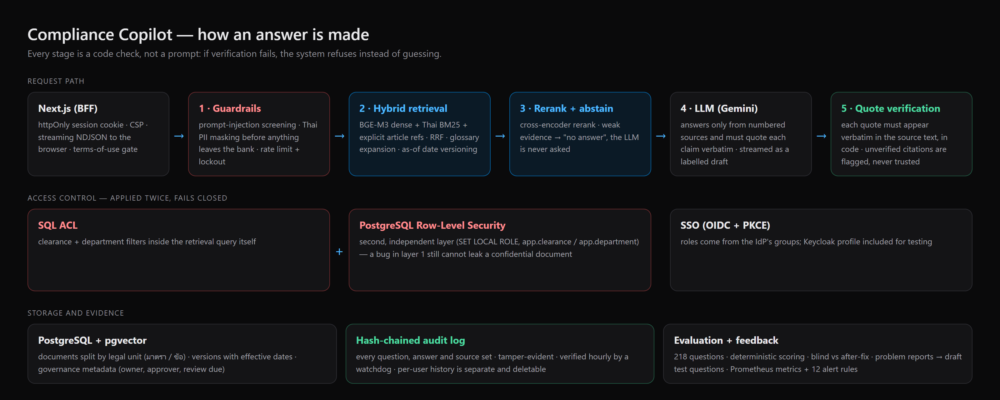

Same flow as a Mermaid diagram (renders on GitHub only)

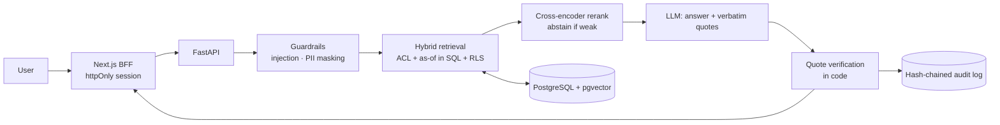

## 5. Screenshots

Every image is an absolute URL, so this file can be copied into another site and the pictures still load.
Captions are written to be reused. All screens use synthetic internal policies and demo accounts.

| | |
|---|---|
| 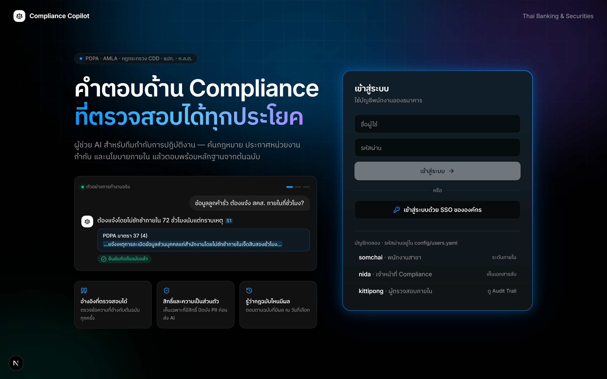 **Sign-in.** Local accounts or OIDC SSO; five failed attempts lock the account. | 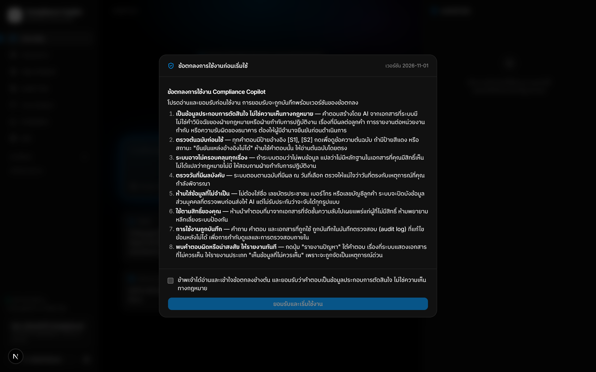 **Acceptable-use terms.** Versioned; the server refuses questions until the current version is accepted, and acceptance is audited. |
| 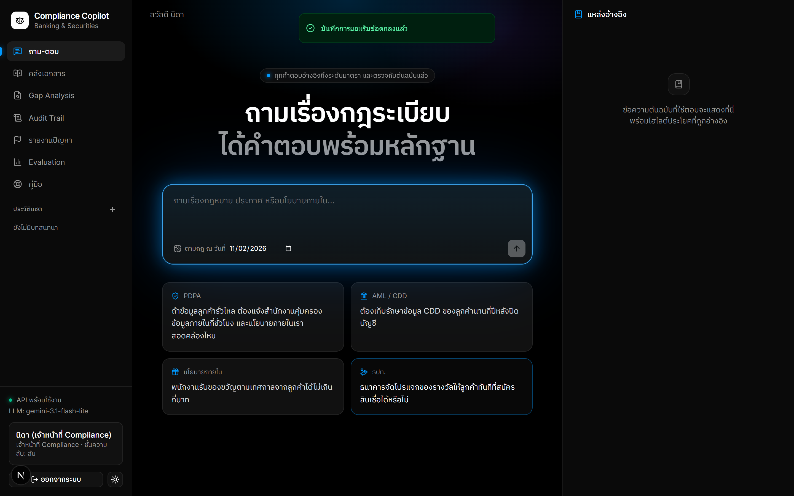 **Ask.** Choose the "as of" date; answers follow the version of the law in force then. | 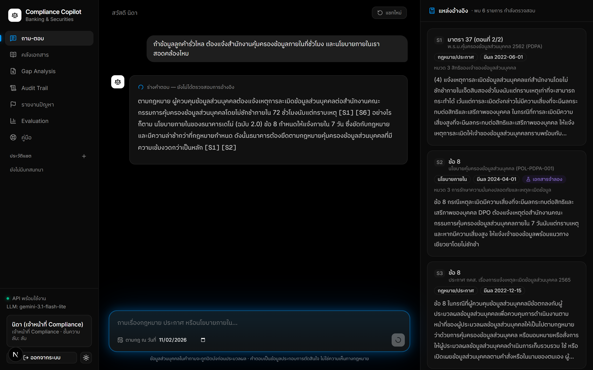 **Streaming.** Real pipeline progress, sources first, then text labelled as an unverified draft. |
|  **Verified answer.** Each citation was checked against the source in code; the quote is highlighted in the original. A synthetic-document warning is shown. | 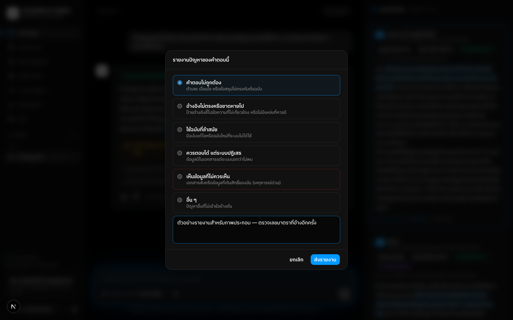 **Report a problem.** Categorised; "saw something I shouldn't" is raised as a security incident immediately. |
| 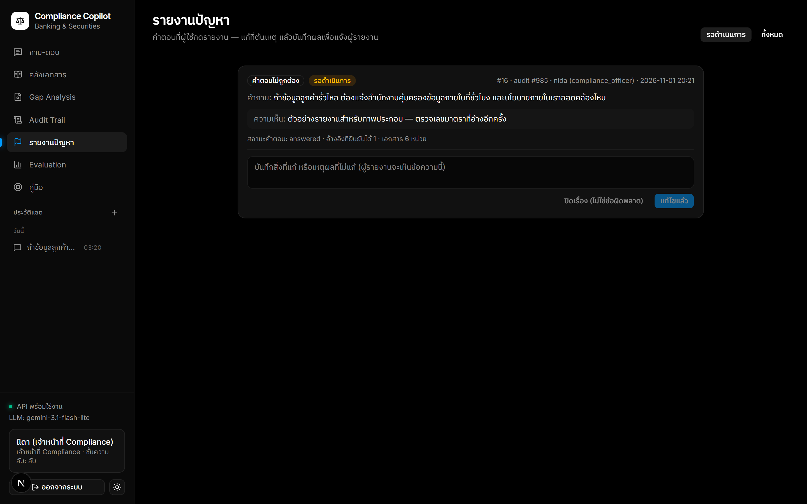 **Triage.** Compliance officers resolve or dismiss a report; the reporter sees the note. | 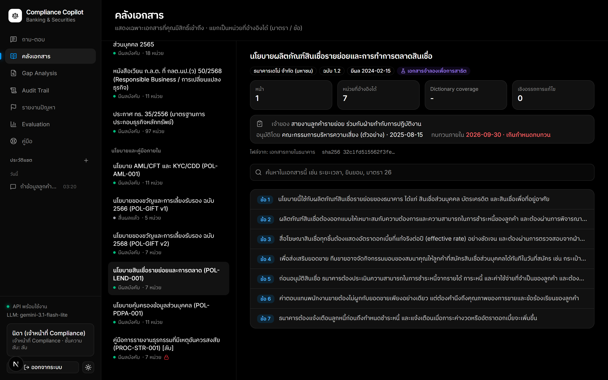 **Document library.** Legal-unit chunks, effective dates, owner / approver / review-due governance panel (here: review overdue). |
| 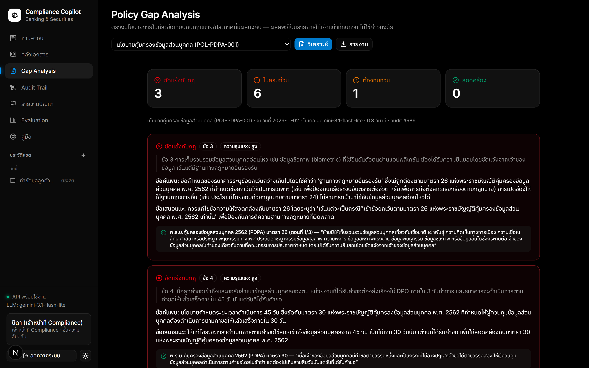 **Policy gap analysis.** Each internal clause checked against the law, with verified quotes. | 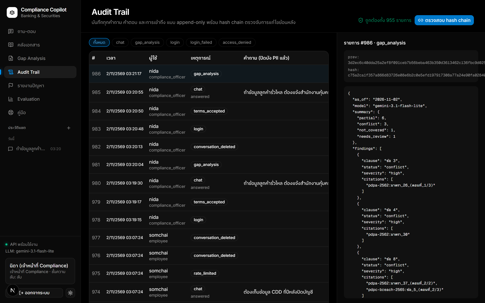 **Audit trail.** Hash-chained; one click re-verifies the whole chain. |
| 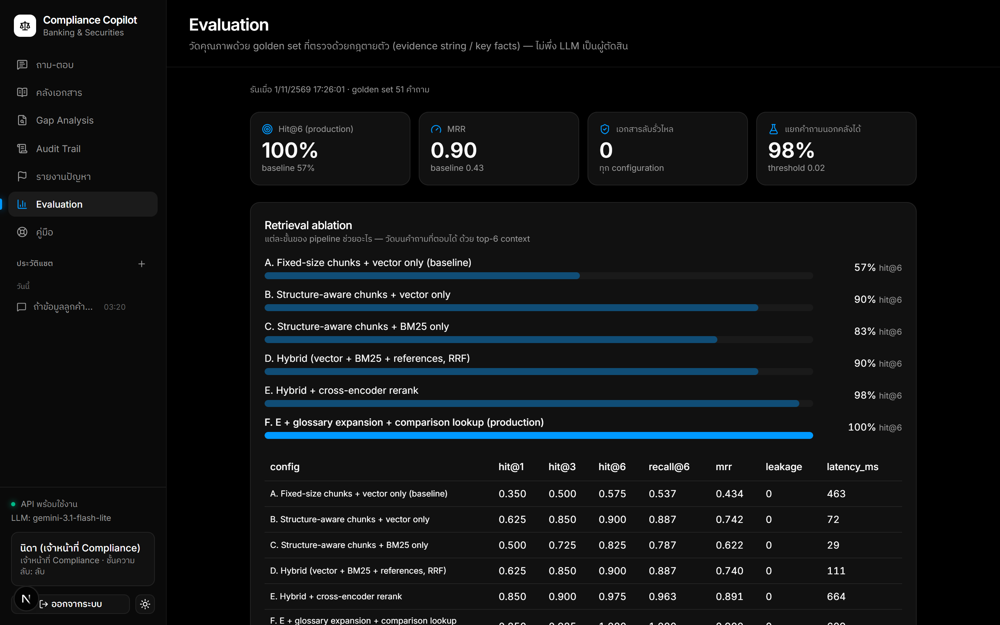 **Evaluation dashboard.** Blind vs after-fix results, per category. | 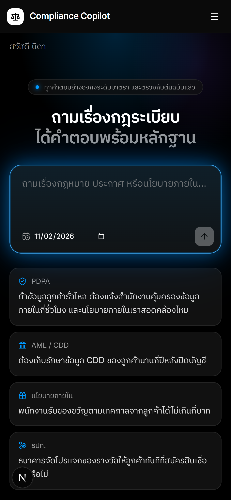 **Mobile.** Same app on a phone viewport. |

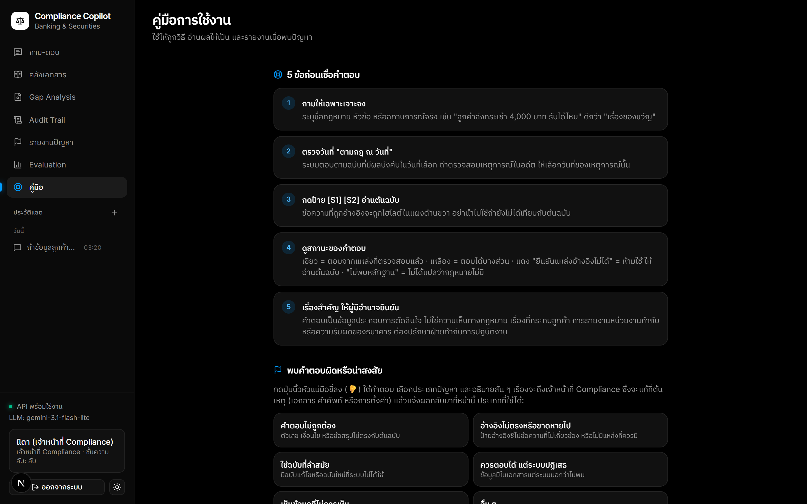

## 6. Results (honest version)

218 evaluation questions in three sets, scored with deterministic checks (evidence strings, required facts, quote verification), not an LLM judge.

| | Retrieval Hit@6 | Correct behaviour | Notes |
|---|---|---|---|
| Baseline (fixed chunks + vector search) | 51.6–57.5% | | what most RAG demos do |
| Golden set (51) — *used for tuning* | **100%** | 100% | optimistic by construction |
| Held-out set (21) — **first, blind run** | 94.1% | 85.7% | found 3 real defects → fixed |
| Extended set (146) — **first, blind run** | 92.2% | 94.5% | key facts 91.4% |

- Confidential-document leakage: **0** in every configuration and set. PII masked in all test cases. Cited quotes found verbatim in the source: 95.9–98%.
- Chunking by legal unit (มาตรา/ข้อ) alone lifted Hit@6 from 57.5% to 90%.
- Latency: one user ≈ 0.5 s for retrieval on an 8 GB GPU; ≈ 2 questions/second per process (models sit behind one lock); end-to-end answer p50 3.5 s / p95 8.8 s.
- 550 automated tests; CI on every push.

**What these numbers do not prove:** all questions were written by engineers and none is confirmed by a compliance expert yet; the internal policies are synthetic samples; it has not been used by real users or penetration-tested. The repository says so, and ships the tooling (Excel export/import with stale-review detection) to close that gap.

## 7. Engineering stories worth telling

1. **A held-out set found what the tuned set hid.** After reaching 100% on my 51 questions I wrote 21 new ones in the way staff actually ask and ran them once, blind: 85.7% behaviour. Three real bugs: the system repeated an internal policy's wrong 45-day deadline instead of the law's 30 days; a too-high abstain threshold refused answerable colloquial questions; a name after "คุณ" wasn't masked. I fixed them, kept the blind numbers in the repo, and labelled the post-fix numbers as no longer blind.
2. **My own gold answers were wrong.** A validator that checks every expected quote against the corpus caught quotes broken by PDF line breaks; reading failed answers showed three expected wordings were too strict. I corrected only what could be verified (stored answers were truncated at 600 characters, so facts could only be credited, never withdrawn) and kept the as-run results.
3. **A negative result I did not ship.** Reranking with the original question instead of the glossary-expanded one improved the new set by 1.5 points but dropped the held-out set from 100% to 94.1%. Documented and rejected.
4. **Streaming vs. "no verification, no answer".** Citations can only be verified when generation ends, so streamed text is shown as a labelled draft and replaced by the verified answer. Testing against the real API exposed intermittent 503 stream drops, which the blocking path had been hiding behind retries; the fix restarts the generation and tells the UI to discard the draft. A disconnect after a draft was shown is audited.
5. **The first CI run found two bugs my machine hid:** route types missing in a clean checkout, and a government server that omits its intermediate TLS certificate (Windows fetches it silently, Linux doesn't). Fixed by shipping the verified intermediate certificate rather than turning TLS verification off.
6. **Security checks that fail loudly.** In production mode the API refuses to start if demo accounts still have their published passwords — I watched it do exactly that when I restored development data into the production stack.

## 8. Ready-to-paste résumé bullets

- Built an end-to-end RAG assistant for Thai banking/securities compliance (FastAPI, PostgreSQL/pgvector, BGE-M3 + reranker, Gemini, Next.js) with code-verified citations to the exact section of the law and calibrated abstention; 0 confidential-document leakage across 218 evaluation questions.
- Designed a deterministic evaluation harness (218 questions, ablation, threshold calibration, blind held-out sets); showed structure-aware chunking and hybrid retrieval + reranking raised Hit@6 from ~52–57% to 92–100%, and reported blind vs. tuned results separately.
- Engineered Thai-PDF repair and legal-structure parsing (broken SARA AM, swapped glyphs, OCR fallback) that made Thai statutes searchable.
- Implemented defence-in-depth access control (SQL ACL + PostgreSQL row-level security), PII masking, OIDC SSO, hash-chained audit log, rate limiting and lockout.
- Shipped streaming answers with a verified-citation guarantee, containerised the stack (Docker, production compose), added CI/CD, Prometheus alerting on answer-trustworthiness metrics, and a tested backup/restore.
- Wrote the governance material for rollout: model-risk dossier with an auto-generated evidence pack, user training plan, incident process.

## 9. สรุปภาษาไทย

**Compliance Copilot** — ผู้ช่วย AI สำหรับทีม Compliance ธนาคารและธุรกิจหลักทรัพย์ ตอบคำถามเรื่อง PDPA, พ.ร.บ.ฟอกเงิน, กฎกระทรวง CDD, ประกาศ ธปท. และ ก.ล.ต. พร้อมนโยบายภายใน
โดยยึดหลัก **ไม่มีหลักฐานที่ตรวจสอบได้ = ไม่ตอบ**

**ทำอะไรได้**
- ทุกประโยคอ้างอิงถึงระดับมาตรา/ข้อ และ **โค้ดตรวจว่าข้อความที่โมเดลอ้างมีอยู่ในต้นฉบับจริง** ถ้าตรวจไม่ผ่านจะแสดงต้นฉบับแทนคำตอบ
- ปฏิเสธเมื่อหลักฐานไม่พอ ตอบตามฉบับที่มีผลบังคับ ณ วันที่เลือก
- สิทธิ์เข้าถึงเอกสารบังคับสองชั้น (SQL และ Row-Level Security) ปิดบังข้อมูลส่วนบุคคลก่อนส่งให้ AI บันทึกตรวจสอบแบบ hash chain
- ตรวจนโยบายภายในเทียบกฎหมายเป็นรายข้อ (Gap Analysis)
- ซ่อมข้อความไทยจาก PDF ราชการที่เพี้ยน แยกโครงสร้างมาตรา/ข้อ และ OCR หน้าสแกน

**ผลการวัด** — คำถามทดสอบ 218 ข้อ ตรวจด้วยเกณฑ์ที่กำหนดผลได้ ไม่ใช้ LLM ตัดสิน

| ชุด | ค้นพบถูก (Hit@6) | พฤติกรรมถูก |
|---|---|---|
| baseline (แบ่งเอกสารตามขนาด + vector) | 52–58% | |
| golden 51 ข้อ (ใช้จูนระบบ) | 100% | 100% |
| held-out 21 ข้อ รอบแรกแบบ blind | 94.1% | 85.7% |
| extended 146 ข้อ รอบแรกแบบ blind | 92.2% | 94.5% |

เอกสารลับรั่วไหล 0 ทุกชุด · quote ตรงต้นฉบับ 95.9–98% · 550 เทสต์ · CI ทุกครั้งที่ push

**ข้อจำกัดที่บอกตรง ๆ** — คำถามทดสอบเขียนโดยผู้พัฒนา ยังไม่มีผู้เชี่ยวชาญยืนยันเฉลย; นโยบายภายในเป็นข้อมูลจำลอง; ยังไม่เคยใช้กับผู้ใช้จริงและยังไม่ผ่านการเจาะระบบ

**เรื่องเล่าที่ควรเน้นตอนสัมภาษณ์** — ชุดทดสอบที่ไม่เคยเห็น (blind) เปิดเผยบั๊กที่ชุดที่จูนแล้วซ่อนไว้ 3 จุด; เฉลยของผมเองผิด 4 จุดและแก้อย่างเปิดเผย;
การทดลองที่ได้ผลเสียต่อชุดอื่นจึงไม่นำมาใช้; streaming ต้องไม่ละเมิดหลักการ "ตรวจก่อนตอบ" จึงแสดงเป็นร่างที่ระบุชัดเจน;
CI รอบแรกเจอ 2 ปัญหาที่เครื่องผมมองไม่เห็น (รวมเซิร์ฟเวอร์รัฐที่ไม่ส่ง certificate กลาง) และแก้โดยไม่ปิดการตรวจ TLS

**ต่อยอด** — ให้ทีม compliance ยืนยันเฉลย (มีเครื่องมือ Excel/ledger พร้อม), เชื่อม SSO กับระบบจริง, ขยายคลังกฎหมาย, นำร่องกับผู้ใช้ 5–10 คน ดู `docs/readiness-checklist.md`

## 10. Links inside the repo

| ต้องการ | ไฟล์ |
|---|---|
| ภาพรวมและวิธีรัน | [README.md](../README.md) |
| สถาปัตยกรรมและเหตุผลการออกแบบ | [architecture.md](architecture.md) |
| ผลทดสอบและข้อผิดพลาดที่พบ | [evaluation.md](evaluation.md) |
| ความปลอดภัย / deploy / ความสามารถรองรับ | [security.md](security.md), [deployment.md](deployment.md) |
| คู่มือเตรียมสัมภาษณ์ (ไทย) | [interview-guide.md](interview-guide.md) |
| บทเดโม 4 นาที | [demo-script.md](demo-script.md) |
| สถานะความพร้อมและสิ่งที่ยังต้องทำ | [readiness-checklist.md](readiness-checklist.md) |
| ภาพหน้าจอและแผนภาพ (14 ไฟล์ PNG) | [images/](images/) |
